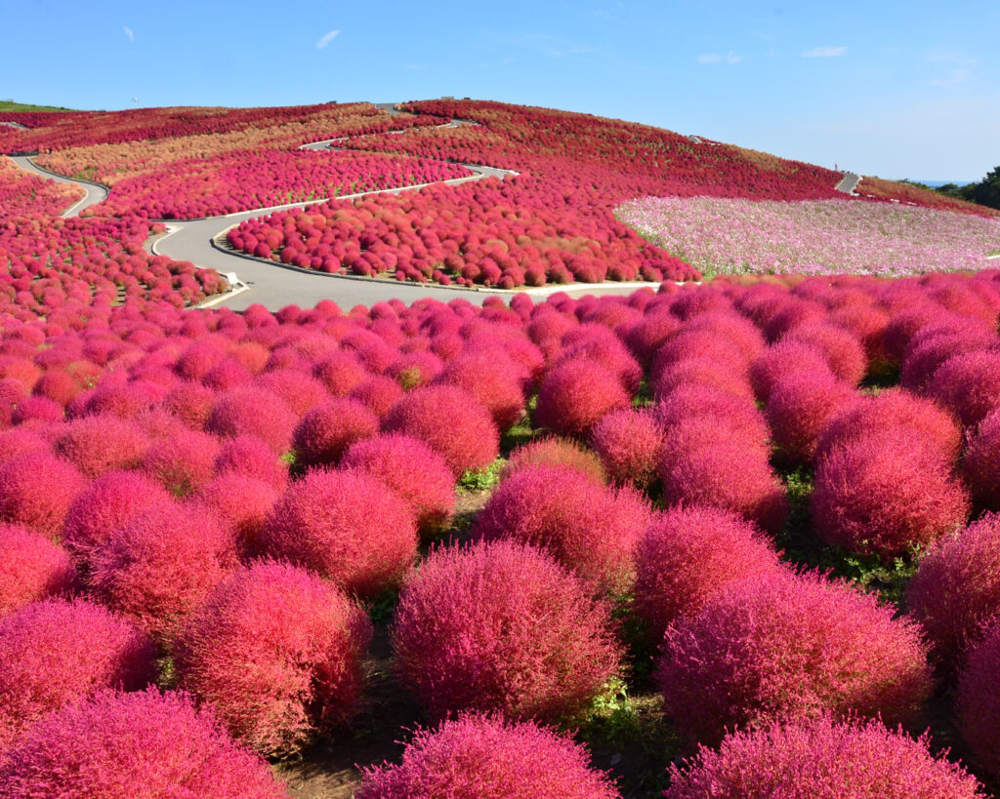

# 🗾 Ibaraki Discovery

**Votre portail personnalisé pour une aventure japonaise authentique**

Ibaraki Discovery est une plateforme web moderne dédiée à la promotion du tourisme durable dans la préfecture d'Ibaraki, Japon. Le site offre une expérience personnalisée pour découvrir les trésors cachés de cette région située à seulement 1h-1h30 de Tokyo.



## ✨ Fonctionnalités

### 🏠 Page d'Accueil
- Hero section spectaculaire avec image de fond
- Barre de recherche intelligente
- Catégories d'exploration (Nature, Culture, Gastronomie, Détente)
- Lieux incontournables mis en avant
- Statistiques clés sur Ibaraki

### 🔍 Page Découverte
- **Système de filtres avancés** :
  - Par activités (Nature, Culture, Spiritualité, etc.)
  - Par régions (Nord, Centre, Sud, Côte)
  - Par villes (Mito, Hitachinaka, Tsukuba, etc.)
  - Par saisons (Printemps, Été, Automne, Hiver)
  - Par accessibilité (Facile, Modéré, Difficile)
- Recherche textuelle en temps réel
- Affichage en grille responsive
- Cartes de lieux avec informations clés

### 📍 Pages Détail des Lieux
- Galerie d'images
- Description complète
- Informations pratiques (horaires, tarifs, accès)
- Activités disponibles
- Meilleures saisons de visite
- Liens vers Google Maps et site officiel
- Badge d'accessibilité

### 🎉 Page Festivals & Événements
- Calendrier saisonnier des festivals
- Filtres par saison et type d'événement
- Cartes détaillées pour chaque festival
- Informations sur les activités et dates

### 🗺️ Constructeur d'Itinéraire Personnalisé
- **Étape 1** : Sélection des centres d'intérêt
- **Étape 2** : Configuration du voyage (durée, budget, saison, accessibilité)
- **Étape 3** : Génération automatique d'un itinéraire personnalisé
- Recommandations de lieux basées sur les préférences
- Festivals correspondant à la saison choisie
- Options de téléchargement et partage

### ℹ️ Page À Propos
- Mission et valeurs du projet
- Raisons de visiter Ibaraki
- Informations de contact

## 🛠️ Technologies Utilisées

- **React 18.3.1** - Framework JavaScript
- **Vite 5.1.4** - Build tool ultra-rapide
- **React Router DOM 6.22.0** - Navigation côté client
- **Tailwind CSS 3.4.1** - Framework CSS utility-first
- **Framer Motion 11.0.5** - Animations fluides
- **Lucide React 0.344.0** - Icônes modernes

## 📦 Installation

```bash
# Cloner le repository
git clone [url-du-repo]

# Naviguer dans le dossier
cd ibaraki-discovery

# Installer les dépendances
npm install

# Lancer le serveur de développement
npm run dev

# Build pour la production
npm run build

# Prévisualiser le build de production
npm run preview
```

## 🚀 Démarrage Rapide

1. Le serveur de développement démarre sur `http://localhost:5173/`
2. Les modifications sont appliquées en temps réel (Hot Module Replacement)
3. Toutes les images sont dans le dossier `public/Photo/`

## 📁 Structure du Projet

```
ibaraki-discovery/
├── public/
│   └── Photo/              # Images des lieux et festivals
├── src/
│   ├── components/         # Composants réutilisables
│   │   ├── Header.jsx
│   │   ├── Footer.jsx
│   │   ├── Layout.jsx
│   │   └── PlaceCard.jsx
│   ├── pages/              # Pages de l'application
│   │   ├── Home.jsx
│   │   ├── Discovery.jsx
│   │   ├── PlaceDetail.jsx
│   │   ├── Festivals.jsx
│   │   ├── Itinerary.jsx
│   │   └── About.jsx
│   ├── data/               # Données JSON
│   │   ├── places.json     # Base de données des lieux
│   │   └── festivals.json  # Base de données des festivals
│   ├── App.jsx             # Composant principal
│   ├── main.jsx            # Point d'entrée
│   └── index.css           # Styles globaux
├── index.html
├── package.json
├── vite.config.js
├── tailwind.config.js
└── postcss.config.js
```

## 🎨 Design

- **Palette de couleurs** :
  - Primary : Rouge (#DC2626 - #991B1B)
  - Secondary : Vert (#059669 - #047857)
  - Neutral : Gris (#F9FAFB - #111827)

- **Typographie** :
  - Display : Poppins (titres)
  - Sans : Inter (texte)

- **Responsive** : Mobile-first, optimisé pour tous les écrans

## 📊 Base de Données

### Lieux (10+ destinations)
- Hitachi Seaside Park
- Jardin Kairaku-en
- Mont Tsukuba
- Sanctuaire Kashima Jingu
- Grand Bouddha d'Ushiku
- Chutes de Fukuroda
- Sanctuaire Kasama Inari
- Sanctuaire Oarai Isosaki
- Aqua World Oarai
- Lac Kasumigaura

### Festivals (8+ événements)
- Festival des Pruniers de Mito
- Festival des Iris d'Itako
- Rock in Japan Festival
- Festival de la Baudroie d'Oarai
- Festival des Chrysanthèmes de Kasama
- Compétition de Feux d'Artifice de Tsuchiura
- Festival des Fleurs de Pêcher de Koga
- Tsukuba Festival

## 🌟 Fonctionnalités Clés

1. **Filtrage Intelligent** : Système multi-critères pour trouver les lieux parfaits
2. **Personnalisation** : Itinéraires sur mesure basés sur les préférences
3. **Saisonnalité** : Recommandations adaptées à chaque saison
4. **Accessibilité** : Information claire sur le niveau de difficulté
5. **Responsive** : Expérience optimale sur mobile, tablette et desktop

## 🎯 Objectifs du Projet

- Promouvoir le **tourisme durable** à Ibaraki
- Rediriger les visiteurs des destinations surpeuplées
- Offrir une **expérience authentique** du Japon
- Faciliter la **planification de voyage** personnalisée
- Mettre en valeur le **patrimoine culturel et naturel** d'Ibaraki

## 📝 Licence

Ce projet est créé dans le cadre de la promotion touristique de la préfecture d'Ibaraki.

## 📞 Contact

- **Email** : info@ibarakiguide.org
- **Téléphone** : +81-29-226-3800
- **Site officiel** : [Ibaraki Tourism](https://www.ibarakiguide.org/)

---

**Développé avec ❤️ pour promouvoir le tourisme durable à Ibaraki**

